<h2>TensorFlow-FlexUNet-Image-Segmentation-Knee-Osteoporosis-Canny-Edge-Detection (2026/10/10)</h2>
<h3>
Knee Osteoporosis X-Ray Edge Detection: Canny Edge Pseudo Masks Segmentation Challenge
</h3>
Sarah T. Arai 
Software Laboratory antillia.com  
This is the first experiment in Image Segmentation for 
<b>Multi-Class Knee Osteoporosis X-Ray Canny Edge Detection</b>
 based on
our <a href="https://github.com/sarah-antillia/TensorFlow-FlexUNet-Image-Segmentation-Model">TensorFlowFlexUNet Model</a>
 (<b>TensorFlow Flexible UNet Image Segmentation Model for Multiclass</b>) and a 512x512-pixel cropped PNG
 <a href="https://drive.google.com/file/d/1K7z2sA-x9tuYFzdLlqvdtImMq02gsiHl/view?usp=sharing">
Knee-Osteoporosis-Canny-Edge-Detection-ImageMask-Dataset.zip</a> with colorized masks 
(<a href="https://www.apache.org/licenses/LICENSE-2.0">Apache 2.0</a>),  
which was derived by us from the following dataset: 
  
<a href="https://www.kaggle.com/datasets/mohamedgobara/multi-class-knee-osteoporosis-x-ray-dataset/data">
<b>Multi-Class Knee Osteoporosis X-Ray Dataset</b>
</a>  by Mohamed Gobara .
  
This experiment is a new approach to the Knee Osteoporosis X-Ray Edge Detection Segmentation model based on 
<b>Canny Edge Pseudo Masks</b>,  
which differs from conventional image segmentation models.  
 

<b>Actual Image Segmentation for Knee-Osteoporosis Canny Edge Images of 512x512 pixels</b> 
As shown below, the inferred masks resemble the ground-truth masks.  
 
<b>class_color_map = {Normal: green, Osteopenia: yellow, Osteoporosis: dark_red}</b>  
<table>
<tr>
<th width="320" height="auto">Input: image</th>
<th width="320" height="auto">Mask (ground_truth)</th>
<th width="320" height="auto">Prediction: inferred_mask</th>
</tr>
<tr>
<td></td>
<td></td>
<td></td>
</tr>
<tr>
<td></td>
<td></td>
<td></td>
</tr>
<tr>
<td></td>
<td></td>
<td></td>
</tr>
</table>
 

 
<h3>1. Dataset Citation</h3>
The dataset used here was derived from the following two datasets on the Kaggle website.
  
<a href="https://www.kaggle.com/datasets/mohamedgobara/multi-class-knee-osteoporosis-x-ray-dataset/data">
<b>Multi-Class Knee Osteoporosis X-Ray Dataset</b>
</a>  by Mohamed Gobara .
  
The following explanation was taken from the website above.
  
<b>About Dataset</b> 
The dataset used in the research titled <b>Knee Osteoporosis Diagnosis Based on Deep 
Learning</b> <a href="https://link.springer.com/article/10.1007/s44196-024-00615-4">
https://link.springer.com/article/10.1007/s44196-024-00615-4</a>
 (DOI: 10.1007/s44196-024-00615-4) is a comprehensive collection of 1.3 GB of data gathered 
 from various sources. It comprises medical imaging data, specifically X-rays, and associated 
 patient records that are crucial for diagnosing knee osteoporosis.
  
The dataset is divided into three primary categories:  
1. Normal: Images of knees with no signs of osteoporosis. 
2. Osteopenia: Images showing early stages of bone density loss. 
3. Osteoporosis: Images indicating advanced bone density degradation. 
 
This dataset forms the foundation for developing and evaluating deep learning models 
aimed at automating the detection and classification of knee osteoporosis. 
Its well-structured and labeled data ensures robust model performance, 
making it an essential resource for advancements in orthopedic diagnostic tools.
  
<b>License</b> 
<a href="https://www.apache.org/licenses/LICENSE-2.0">Apache 2.0</a>
 
 
<h3>
2. ImageMask-Dataset
</h3>
<h3>2.1 Download ImageMask Dataset</h3>
 If you would like to train this <b>Knee-Osteoporosis-Canny-Edge-Detection</b> Segmentation model,
 please download the dataset from Google Drive  
 <a href="https://drive.google.com/file/d/1K7z2sA-x9tuYFzdLlqvdtImMq02gsiHl/view?usp=sharing">
Knee-Osteoarthritis-Canny-Edge-Detection-ImageMask-Dataset</a>
(<a href="https://www.apache.org/licenses/LICENSE-2.0">Apache 2.0</a>).
Expand the downloaded and put it under the <b>./dataset</b> folder.
 
<pre>
./dataset
└─Knee-Osteoporosis-Canny-Edge-Detection
    ├─test
    │   ├─images
    │   └─masks
    ├─train
    │   ├─images
    │   └─masks
    └─valid
         ├─images
         └─masks
</pre>
 
<b>Knee-Osteoporosis-Canny-Edge-Detection Statistics</b> 
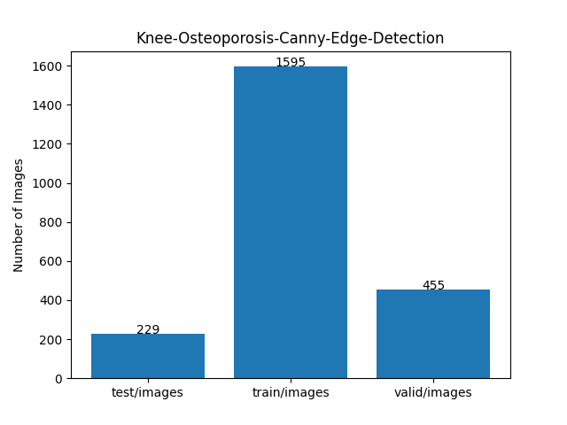 
 
As shown above, the number of images in the training and valid datasets is large enough to use for the
 training set of our segmentation model.
 
<h3>2.2 Derivation of ImageMask Dataset</h3>
The folder structure of our <b>OAI-Images</b> derived from the original dataet excluded <b>Normal</b> is as follows,
but it contains no annotation (mask) files.
 
<pre>
./OS-Colleted-Data
  ├─Normal       (780 files) 
  │   ├─9000622L.png
...
  │   └─9999878L.png 
  │    
  ├─Osteopenia    (374 files)
  │   ├─9000622L.png
...
  │   └─9999878L.png 
  │
  └─Osteoporosis (793 file)
        ├─9012867R.png
...
        └─9997856L.png
</pre>
It consists of three classes image data: Normal, Osteopenia and Osteoporosis
  
<b>Step 1</b> 
We generated a 512x512-pixel cropped master dataset
<a href="https://drive.google.com/file/d/1zSlTebAYM-2H4naJ7pCrwm0NeXnwHZnj/view?usp=sharing">Knee_Osteoporosis_Cropped.zip</a>  from the original image files in 
each subfolders of <b>OS-Colleted-Data</b>.
  
<b>Step 2</b> 
We generated the Canny edge pseudo masks by applying the classic 
<a href="https://docs.opencv.org/5.0/py_tutorials/py_imgproc/py_canny/py_canny.html">
<b>Canny Edge Detection</b> </a> to all master images.
  
<b>Step 3</b> 
We generated the first <b>Knee-Osteoporosis-Canny-Edge-Detection-ImageMask-Dataset</b> 
from all pairs of the master images and their corresponding Canny edge pseudo masks by using a
simple Python script <a href="./generator/ImageMaskDatasetGenerator.py">
ImageMaskDatasetGenerator.py
</a>.  
  
<b>Step 4</b> 
We generated a pretrained FlexUNet Segmentation Model by using the first 
<b>ImageMask-Dataset</b>. 
 
<b>Step 5</b> 
We generated the second pseudo masks by applying the segmentation (inference) method of 
the pretrained FlexUNet Model to the cropped master images. 
 
<b>Step 6</b> 
We generated curated pseudo masks from the second pseudo masks generated in the previous step by using a 
simple Python script to exclude the inappropriate pseudo masks.  
<b>Step 7</b> 
We finally generated the second 
 <a href="https://drive.google.com/file/d/1K7z2sA-x9tuYFzdLlqvdtImMq02gsiHl/view?usp=sharing">
Knee-Osteoarthritis-Canny-Edge-Detection-ImageMask-Dataset</a> from all pairs of the master images and their corresponding curated pseudo masks
by using our Python script <a href="./generator/AugmentationTool.py">AugmentationTool.py</a>
  

<h3>2.3 Train Sample Images and Masks</h3>
<b>Train_sample_images</b> 
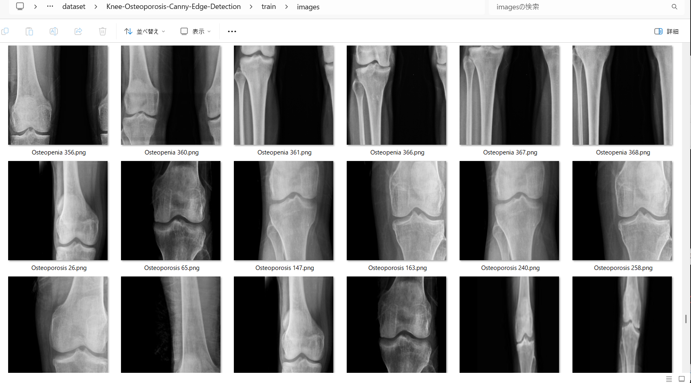
 
<b>Train_sample_masks</b> 
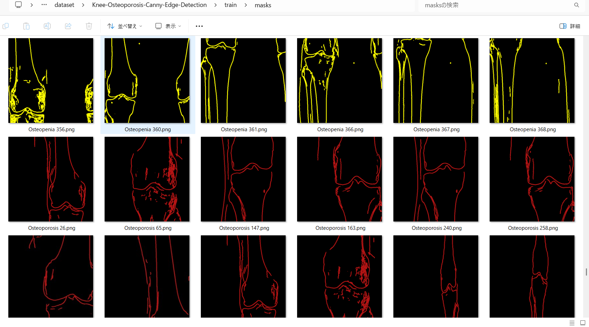
 
<h3>
3. Train TensorFlowFlexUNet Model
</h3>
 We trained the Knee-Osteoporosis-Canny-Edge-Detection TensorFlowFlexUNet model using the following
<a href="./projects/TensorFlowFlexUNet/Knee-Osteoporosis-Canny-Edge-Detection/train_eval_infer.config"> <b>train_eval_infer.config</b></a> file.  
Please move to ./projects/TensorFlowFlexUNet/Knee-Osteoporosis-Canny-Edge-Detection and run the following bat file. 
<pre>
>1.train.bat
</pre>
This runs the following command. 
<pre>
>python ../../../src/TensorFlowFlexUNetTrainer.py ./train_eval_infer.config
</pre>

<b>Model parameters</b> 
Defined a small <b>base_filters=16 </b> and large <b>base_kernels=(11,11)</b> for the first Conv Layer of Encoder Block of 
<a href="./src/TensorFlowFlexUNet.py">TensorFlowFlexUNet.py</a> 
and a large <b>num_layers=8</b> (including a bridge between Encoder and Decoder Blocks).
<pre>
[model]
; You may specify your own UNet class derived from our TensorFlowFlexModel
model         = "TensorFlowFlexUNet"
generator     =  False
image_width    = 512
image_height   = 512
image_channels = 3
num_classes    = 4
base_filters   = 16
base_kernels   = (11,11)
num_layers     = 8
dropout_rate   = 0.04
dilation       = (1,1)
</pre>
<b>Learning rate</b> 
Defined a small learning rate.  
<pre>
[model]
learning_rate  = 0.00007
</pre>
<b>Loss and metrics functions</b> 
Specified "categorical_focal_dice_loss" and <a href="./src/dice_coef_multiclass.py">"dice_coef_hybrid"</a>,
and weight parameters <b>hybrid_alpha</b> and <b>hybrid_beta</b> for <b>dice_coef_hybrid</b> function. 
<pre>
[model]
loss           = "categorical_focal_dice_loss"
metrics        = ["dice_coef_hybrid"]
; Experimental two weight parameters to calculate "dice_coef_hybrid" metric.
hybrid_alpha   = 1.6
hybrid_beta    = 0.4
</pre>
<b>Dataset class</b> 
Specifed <a href="./src/ImageCategorizedMaskDataset.py">ImageCategorizedMaskDataset</a> class. 
<pre>
[dataset]
class_name    = "ImageCategorizedMaskDataset"
</pre>
 
<b>Learning rate reducer callback</b> 
Enabled the learning_rate_reducer callback and a small reducer_patience.
<pre> 
[train]
learning_rate_reducer = True
reducer_factor     = 0.5
reducer_patience   = 4
</pre>
<b>Early stopping callback</b> 
Enabled early stopping callback with the patience parameter.
<pre>
[train]
patience      = 10
</pre>
<b>RGB Color map</b> 
Specified RGB color map dict for Knee-Osteoporosis-Canny-Edge-Detection 1+3 classes. 
<pre>
[mask]
mask_datatype    = "categorized"
mask_file_format = ".png"
;Knee-X-Ray RGB color map dict for 1+3 classes.
;                    "Normal":green, "Osteopenia":yellow, "Osteoporosis":dark_red,
rgb_map = {(0,0,0):0,(0,255,0):1, (255,255,0):2,(180,20,20):3}
</pre>
<b>Epoch change inference callback</b> 
Enabled <a href="./src/EpochChangeInferencer.py">epoch_change_infer callback</a></b>. 
<pre>
[train]
epoch_change_infer       = True
epoch_change_infer_dir   =  "./epoch_change_infer"
num_infer_images         = 6
</pre>

By using this callback, on every epoch change, the inference procedure can be called
 for 6 images in the <b>mini_test</b> folder. This will help you confirm how the predicted mask changes 
 at each epoch during your training process.  
  
As shown below, early in the model training, the predicted masks from our UNet segmentation model showed 
discouraging results.
 However, as training progressed through the epochs, the predictions gradually improved. 
   
 
<b>Epoch_change_inference output at starting (epoch 1, 2, 3)</b> 
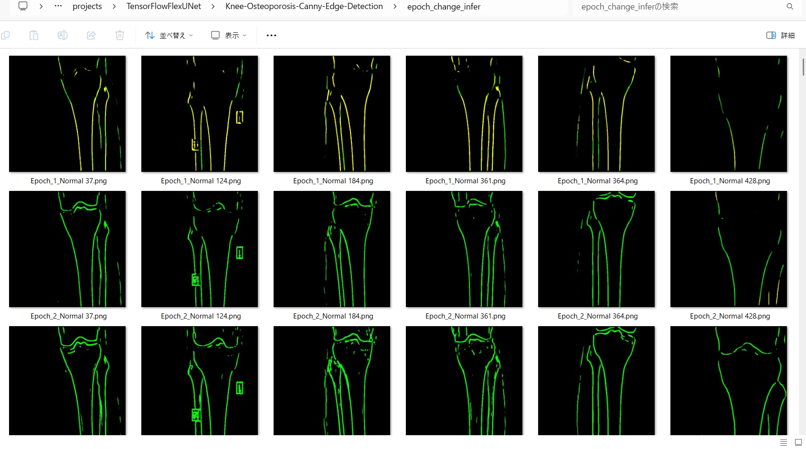 
 
<b>Epoch_change_inference output at middlepoint (epoch 28, 39, 30)</b> 
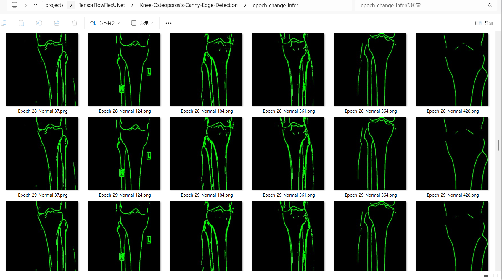 
 
<b>Epoch_change_inference output at ending (epoch 58, 59, 60)</b> 
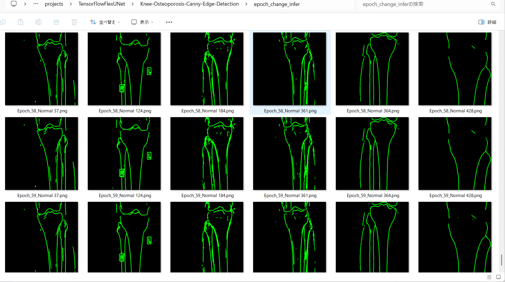 
 
In this experiment, the training process was terminated at epoch 60. 
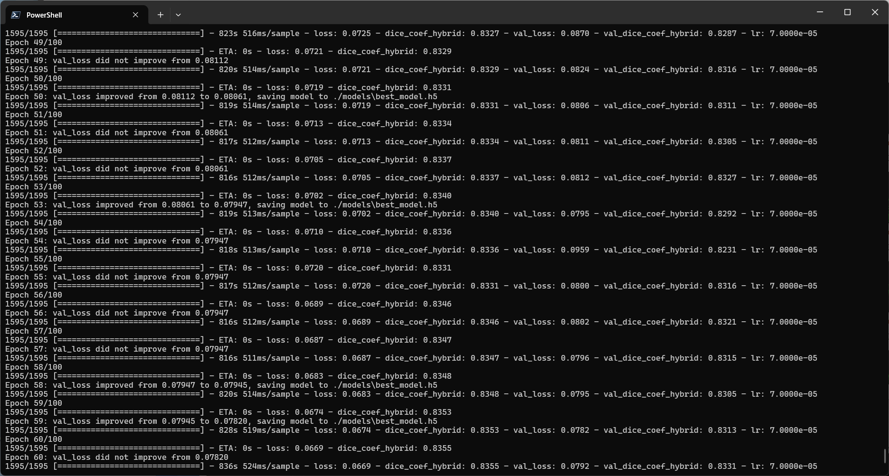 
 
<a href="./projects/TensorFlowFlexUNet/Knee-Osteoporosis-Canny-Edge-Detection/eval/train_metrics.csv">train_metrics.csv</a> 
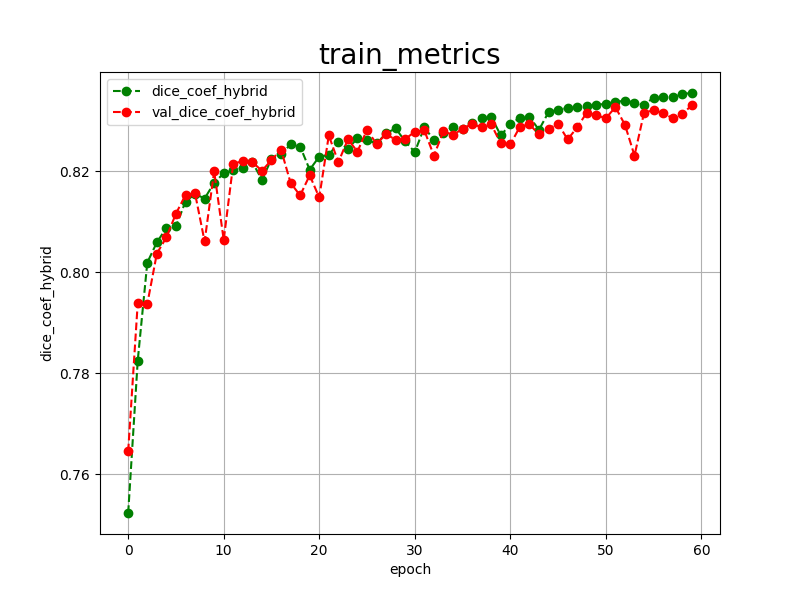 
 
<a href="./projects/TensorFlowFlexUNet/Knee-Osteoporosis-Canny-Edge-Detection/eval/train_losses.csv">train_losses.csv</a> 
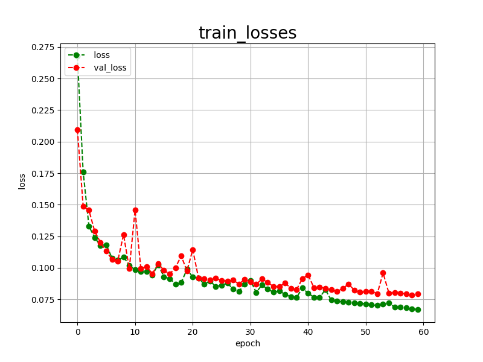 
 
<h3>
4. Evaluation
</h3>
Please move to <b>./projects/TensorFlowFlexUNet/Knee-Osteoporosis-Canny-Edge-Detection</b> folder,
and run the following bat file to evaluate the TensorFlowUNet model for Knee-Osteoporosis-Canny-Edge-Detection. 
<pre>
>./2.evaluate.bat
</pre>
This runs the following command.
<pre>
>python ../../../src/TensorFlowFlexUNetEvaluator.py ./train_eval_infer.config
</pre>

Evaluation console output: 
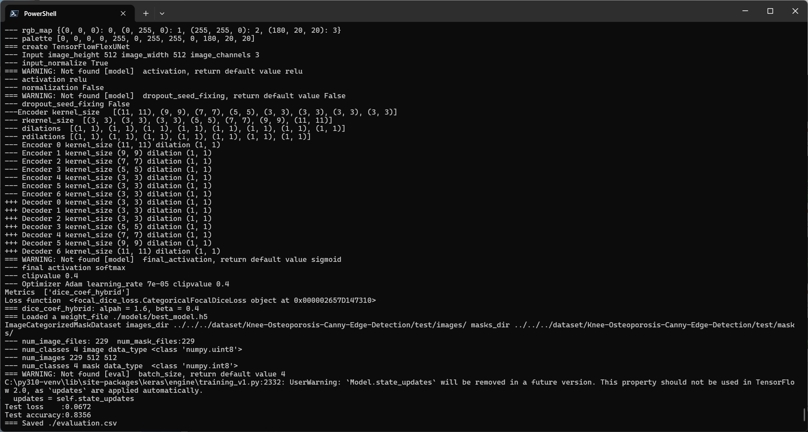
  Image-Segmentation-Knee-Osteoporosis-Canny-Edge-Detection
<a href="./projects/TensorFlowFlexUNet/Knee-Osteoporosis-Canny-Edge-Detection/evaluation.csv">evaluation.csv</a> 
The loss (categorical_focal_dice_loss) on this Knee-Osteoporosis-Canny-Edge-Detection/test was not low, and 
dice_coef_hybrid was not high, as shown below.
 
<pre>
categorical_focal_dice_loss,0.0672
dice_coef_hybrid,0.8356
</pre>
 
<h3>
5. Inference
</h3>
Please move to <b>./projects/TensorFlowFlexUNet/Knee-Osteoporosis-Canny-Edge-Detection</b> folder
and run the following bat file to infer segmentation regions for images using the trained TensorFlowUNet model for Knee-Osteoporosis-Canny-Edge-Detection. 
<pre>
>./3.infer.bat
</pre>
This runs the following command.
<pre>
>python ../../../src/TensorFlowFlexUNetInferencer.py ./train_eval_infer.config
</pre>

<b>mini_test_images</b> 
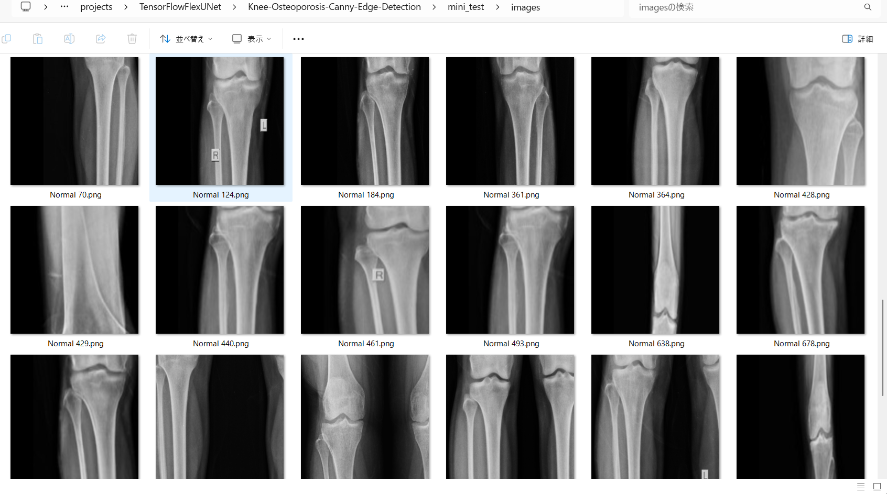 
<b>mini_test_mask(ground_truth)</b> 
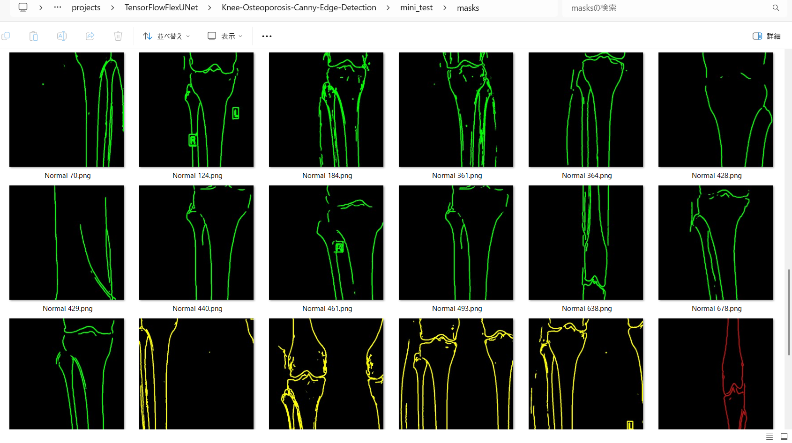 

<b>Inferred test masks</b> 
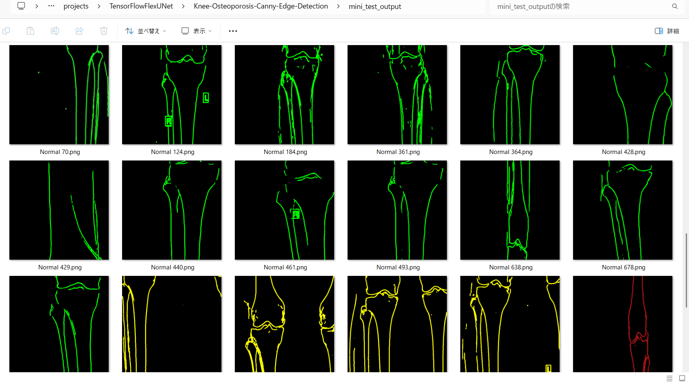 
 

<b>Enlarged images and masks for Knee-Osteoporosis Canny Edge Detection Images of 512x512 pixels</b> 
As shown below, the inferred masks look similar to the ground truth masks except for the second and fourth cases. 
 
<b>class_color_map = {Normal: green, Osteopenia: yellow, Osteoporosis: dark_red} </b>  
<table>
<tr>
<th width="320" height="auto">Image</th>
<th width="320" height="auto">Mask (ground_truth)</th>
<th width="320" height="auto">Inferred-mask</th>
</tr>
<tr>
<td></td>
<td></td>
<td></td>
</tr>
<tr>
<td></td>
<td></td>
<td></td>
</tr>
<tr>
<td></td>
<td></td>
<td></td>
</tr>
<tr>
<td></td>
<td></td>
<td></td>
</tr>
<tr>
<td></td>
<td></td>
<td></td>
</tr>
<tr>
<td></td>
<td></td>
<td></td>
</tr>
</table>

 
<h3>
References
</h3>
<b>1. Knee Osteoporosis Diagnosis Based on Deep Learning</b> 
Amany M. Sarhan, Mohamed Gobara, Shady Yasser, Zainab Elsayed, Ghada Sherif, 
 Nada Moataz, Yasmen Yasir, Esraa Moustafa, Sara Ibrahim & Hesham A. Ali  
<a href="https://link.springer.com/article/10.1007/s44196-024-00615-4">https://link.springer.com/article/10.1007/s44196-024-00615-4</a>
  
<b>2. TensorFlow-FlexUNet-Image-Segmentation-OAI-Knee-Osteoarthritis-Canny-Edge-Detection </b> 
Toshiyuki Arai 
<a href="https://github.com/sarah-antillia/TensorFlow-FlexUNet-Image-Segmentation-OAI-Knee-Osteoarthritis-Canny-Edge-Detection">
https://github.com/sarah-antillia/TensorFlow-FlexUNet-Image-Segmentation-OAI-Knee-Osteoarthritis-Canny-Edge-Detection
</a>
  
<b>3. TensorFlow-FlexUNet-Image-Segmentation-Model</b> 
Toshiyuki Arai 
<a href="https://github.com/sarah-antillia/TensorFlow-FlexUNet-Image-Segmentation-Model">
https://github.com/sarah-antillia/TensorFlow-FlexUNet-Image-Segmentation-Model
</a>
  

